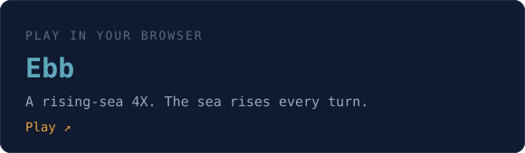

  

Cofounder at [Kaizan](https://kaizan.ai). I've spent 23+ years building products and engineering teams: six startups, and a stint at Meta. These days I'm building Kaizan, and in my spare time I make small, odd things.

  
  

### ≈ Try it on your GitHub

- **[Character Sheet](https://pravin.github.io/charsheet/)**: your GitHub profile as a Hollowmoon roguelike character
- **[Lifelines](https://pravin.github.io/lifelines/)**: your projects drawn as lifelines, as a shareable poster

### ≈ Selected work

- **[hugo-theme-prav](https://github.com/pravin/hugo-theme-prav)**: the Hugo theme behind my blog
- **[Hugo themes](https://github.com/pravin?tab=repositories&q=hugo-theme)**: [transit](https://github.com/pravin/hugo-theme-transit), [bookshelf](https://github.com/pravin/hugo-theme-bookshelf) and [drafting](https://github.com/pravin/hugo-theme-drafting) draw your archive as a transit map, a bookshelf and an engineering drawing
- **[cwordle](https://github.com/pravin/cwordle)**: Wordle in your terminal, in Rust
- **[fix-webcam-linux](https://github.com/pravin/fix-webcam-linux)**: scripts to make your Linux webcam look good

Everything else is at **[pravin.github.io](https://pravin.github.io)**.

  <a href="https://cto.me.uk">cto.me.uk</a> ·
  <a href="https://linkedin.com/in/pravinp">LinkedIn</a> ·
  <a href="https://twitter.com/pravin">Twitter</a>

